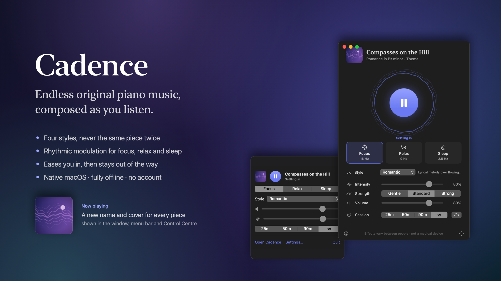
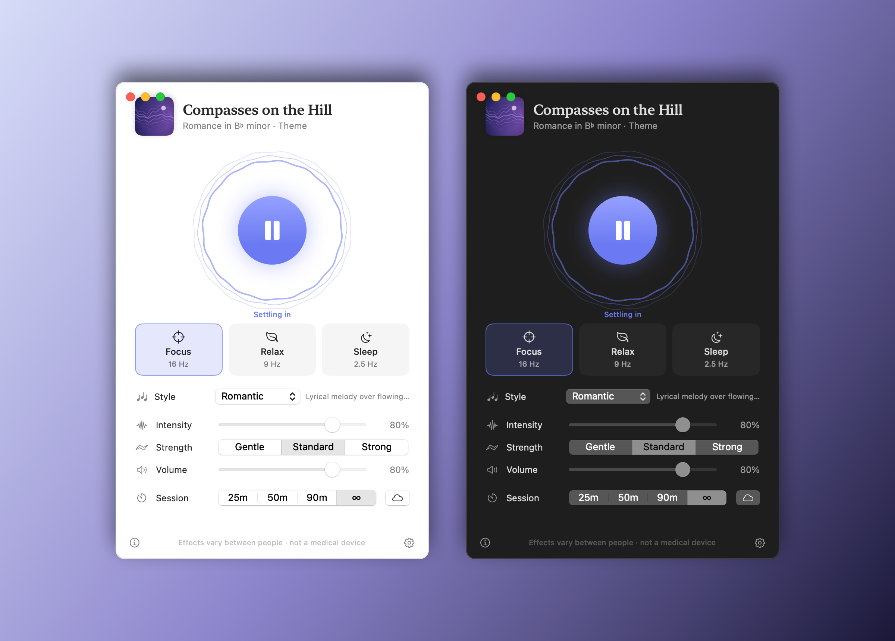
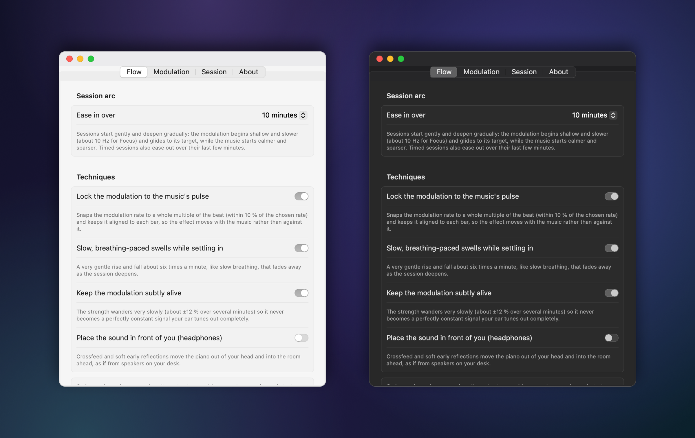
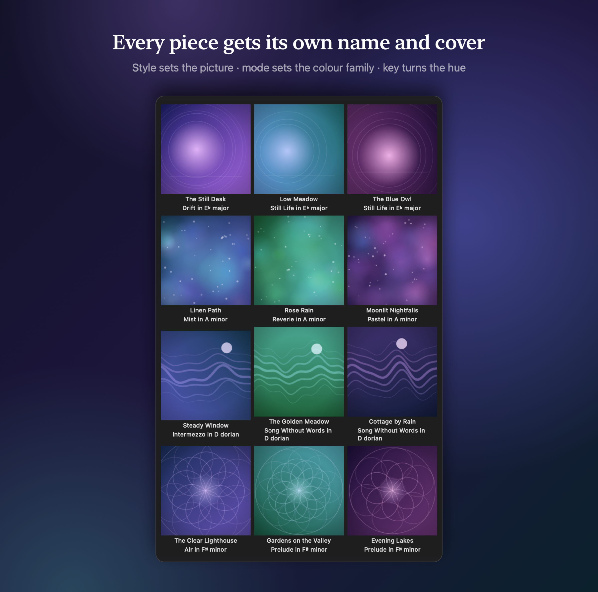

<div align="center">



<br>

**Endless, original, calm piano music, composed in real time on your Mac, with optional rhythmic modulation for focus, relaxation and sleep.**

[](#install)
[](Package.swift)
[](#privacy)
[](Tests)
[](LICENSE)
[](LICENSES.md)

</div>

---

Cadence is a native macOS app that **composes** piano music as you listen. It doesn't play back recordings or
loops. A rules-based composer writes themes, harmonies and counter-melodies bar by bar, forever, and a sampled
concert grand plays them. Underneath, an optional amplitude-modulation layer, inspired by published research on
rhythmic sound and attention, gently pulses the mix at a rate chosen for each mode.

> **Honest framing.** Effects on focus, relaxation or sleep **vary between people**, and some people notice
> nothing. Cadence is not a medical device and makes no medical or therapeutic claims. Turn the modulation off
> any time if you simply want the piano.

## Highlights

| | |
|---|---|
| 🎹 **Never the same piece twice** | Four styles: Minimalist, Impressionist, Romantic and Baroque. Each piece has a real form: themes, contrasts, modulations, cadences. |
| 🌊 **Modulation that fits you** | Focus (16 Hz), Relax (9 Hz) and Sleep (2.5 Hz). Gentle, Standard or **Strong**. Four waveshapes, alternating stereo, bass-steady option. |
| 🌅 **Eases you in** | Starts shallow, slow and sparse, then deepens over 5–15 minutes. Timed sessions wind down before they fade out. |
| 🤫 **Built to be ignorable** | Salience reduction: no sudden accents, gaps, texture jumps, shrill notes or repeated-note runs. All measured. |
| 🎨 **Names and cover art** | Every piece gets a unique name (*Compasses on the Hill*) and its own generated cover, shown in Now Playing too. |
| 🔒 **Native and private** | SwiftUI + AVAudioEngine, a few percent CPU, no network, no account, no analytics. |

## Screenshots

<p align="center">
  
</p>
<p align="center"><sub>The main window follows your system appearance: piece name and cover, mode, style, intensity, strength, volume and session length.</sub></p>

<p align="center">
  
</p>
<p align="center"><sub>Settings → Flow: session ease-in, pulse-locking, breathing swells, slow variation and headphone spatialisation.</sub></p>

<p align="center">
  
</p>
<p align="center"><sub>Every piece is drawn procedurally: style picks the motif, mode the colour family, key the hue.</sub></p>

## Install

Requires macOS 14 or later and **Xcode** (the Command Line Tools alone can't build SwiftUI apps).

```bash
git clone https://github.com/ryanlippman/Cadence.git
cd Cadence
Scripts/build_app.sh          # builds build/Cadence.app (about 22 MB, samples included)
open build/Cadence.app
```

The app is ad-hoc signed, not notarized. If Gatekeeper complains, right-click the app and choose **Open**.
Drag it to `/Applications` to keep it.

**Using it:** press Space (or the big button) to start and stop. Use ⌘1/⌘2/⌘3 for Focus, Relax and Sleep.
Cadence also lives in the menu bar, and media keys and Control Centre's Now Playing work too.

## The research behind it

Cadence's techniques follow ideas from published work. It applies them as design choices, not as proven
interventions:

- **Rhythmic amplitude modulation and attention:** beta-rate (≈12–20 Hz) modulation in background music
  reduced attentional lapses in sustained-attention tasks (Woods et al., 2019). Stronger modulation helped
  most for listeners reporting more attention difficulties (Woods et al., 2024). Neural entrainment as a
  substrate of attention is reviewed in Calderone et al. (2014).
- **Preferred stimulation differs between people:** introverts and extraverts differ in preferred arousal
  (Geen, 1984) and in how much background music distracts them (Furnham & Bradley, 1997). Arousal
  regulation also differs in ADHD (Strauß et al., 2018). *Hence the Gentle / Standard / Strong presets.*
- **Salience:** sudden, surprising sounds capture attention (auditory saliency models; Kayser et al., 2005).
  *Hence the composer's smoothing of accents, density, register and texture.*
- **Externalised sound:** crossfeed and early reflections make headphone audio seem to come from in front of
  you rather than inside your head.

Cadence is an independent project with no affiliation to any company mentioned in this literature.

## Privacy

Everything runs locally. Cadence makes no network requests and collects nothing. Settings and the list of
used piece names are stored in your user defaults on this Mac.

---

## Under the hood

```
Composer ─ bars ─▶ scheduler ─ note/pedal events ─▶ Sampler ─▶ sympathetic resonance ─▶ FDN reverb
   (form, harmony, voices)        (sample-accurate)    (keys + pedal)                           │
                                                                                                ▼
                       limiter ◀─ master volume / fades ◀─ pink-noise bed ◀─ amplitude modulation (LFO)
```

<details>
<summary><b>Composition engine (rules-based, no ML)</b></summary>

Hierarchical, rules-based — no machine learning, no recordings:

- **Form.** Each *movement* is: theme (a period), often a varied restatement, a pivot-chord transition to a
  related key, a contrasting period, a transition home, the theme's return (recalled from memory with light
  variation), a plagal codetta, and a transition to the next movement's key. Key areas change every minute
  or two; the home key every few minutes.
- **Periods & cadences.** Antecedent phrases end on half cadences; consequents restate the antecedent's
  opening (parallel period) and close with authentic, plagal or deceptive cadences (a deceptive cadence
  gets a cadential extension). Cadential 6/4 in romantic/baroque.
- **Harmony.** Functional grammar (tonic → pre-dominant → dominant), secondary dominants and leading-tone
  sevenths, borrowed chords from the parallel mode, descending-fifth sequences, ostinati (minimalist),
  added-note colour (impressionist).
- **Voice leading.** Bass inversion and three inner voices chosen by minimising motion, holding common tones,
  completing chords, sensible doubling, resolving sevenths and leading tones, and avoiding parallel fifths
  and octaves.
- **Melody.** A motif (rhythm + contour) is stated, answered, varied and fragmented within phrases and developed
  across movements; an arch-shaped contour plan; chord tones on structural beats; passing and neighbour
  tones, suspensions (prepared, resolved down by step), appoggiaturas and turns — every dissonance resolves.
- **Independent voices.** Counter-melody that moves when the melody rests; walking bass (baroque).
- **Styles** (original music in broad traditions, not imitations): *Minimalist* (spacious ostinati,
  Gymnopédie-like 3/4), *Impressionist* (lydian/mixolydian colour, rolled pedalled chords), *Romantic*
  (nocturne arpeggios, lyrical melody, chromatic harmony), *Baroque* (prelude figuration, walking bass,
  counterpoint, sequences). *Varied* changes style between movements; changing style mid-piece goes through a
  codetta and a modulation, so the music never stops.
- **Modes** are orthogonal to style: Focus 64–76 BPM, Relax 58–68, Sleep 55–60 (softer, sparser, darker
  reverb). Switching mode glides tempo and dynamics over a few bars.

</details>

<details>
<summary><b>Piano sampler and DSP</b></summary>

- Custom sampler (kept instead of `AVAudioUnitSampler`: deterministic offline rendering for the analysis
  tests, a real pedal/damper model, release triggers, and sample-accurate scheduling).
- Lossless Salamander subset, 4 velocity layers chosen by nearest layer with continuous, loudness-normalised
  gain (cross-fading two different strikes phase-cancels), Hermite pitch-shifting, onset-trimmed.
- Key + sustain pedal: legato re-pedalling (lift just after each harmony, re-catch within 80 ms), two-stage
  dampers (slower in the bass), undamped top register, re-struck notes replace their previous vibration,
  pseudo round-robin on repeated notes, micro-variation in tuning and level, release noise at −37 dB.
- Sympathetic resonance (24 tuned strings ring while the pedal is down); 8-line FDN reverb with early
  reflections and modulated delays; per-mode reverb time.

</details>

<details>
<summary><b>Modulation options</b></summary>

- Sample-accurate LFO on the full mix after the reverb (so reverb tails don't blur it); double-precision phase,
  no drift (tested over 10 minutes); smoothed depth; large rate changes (e.g. Focus → Sleep) dip out, switch
  and fade back in rather than sweeping audibly.

  | Mode  | Default rate | Range     |
  |-------|--------------|-----------|
  | Focus | 16 Hz        | 12–20 Hz  |
  | Relax | 9 Hz         | 6–12 Hz   |
  | Sleep | 2.5 Hz       | 1–4 Hz    |

  Effective depth = Depth (45 %) × Intensity (80 %) × Strength × mode scale (capped at 90 %). 30 s ramp-in.
  AM, not binaural beats, so it works on speakers.
- **Strength preset** (main window): Gentle ×0.65 / Standard ×1 / Strong ×1.6. Woods et al. (2024) reported
  that stronger modulation helped most for listeners with more attention difficulties; arousal-preference
  research (Geen 1984; Furnham & Bradley 1997) suggests people differ in how much stimulation they prefer.
- **Waveforms** (cross-faded when changed, all corner-free so they never click or buzz): Smooth (sine),
  Rounded, Pulse (brief dips, steady between), Onset (quick rise, slow fall). Average level is held constant.
- **Stereo:** Together, or Alternating (ears half a cycle apart, so the pulse moves gently side to side).
- **Band:** Whole mix, or Above the bass (≈220 Hz split; the low end gets only a quarter of the modulation).
- **Slow variation** (habituation guard, default on): depth wanders ±12 % over minutes (two incommensurate
  slow sines) so the signal never becomes perfectly constant.
- **Spatial / externalisation** (headphones, off by default): crossfeed (0.28 ms, low-passed) plus sparse early
  reflections place the piano in front rather than inside the head.
- Optional pink-noise bed (high- and low-passed), look-ahead limiter (inactive at normal levels), squared
  volume and fade curves.

</details>

<details>
<summary><b>Session arc, flow and salience techniques</b></summary>

Sessions no longer start at full strength:

- **Ease-in** (Off / 5 / 10 / 15 min, default 10): modulation depth starts at 20 % and the rate starts lower
  (Focus 10 Hz, Relax 11 Hz, Sleep 6 Hz) and glides to the target; the music starts calmer (Focus ~60 BPM),
  sparser and softer, and builds gradually. The app shows *Settling in → Deepening focus → Sustained focus*
  (Relax: *Unwinding / Deep rest*; Sleep: *Drifting down / Deep calm*).
- **Ease-out:** timed sessions wind down over their last few minutes (shallower, slower modulation, calmer
  music) before the final fade.
- **Pulse-locked modulation** (default on): the rate snaps to a whole multiple of the music's beat when one is
  within 10 % of the chosen rate, and its phase is nudged to stay aligned with each bar, so the modulation
  moves with the music. (Sleep's slow rates usually don't fall near a beat multiple and run free.)
- **Breathing-paced swells** (default on): a ±1.5 dB swell at 0.1 Hz (≈6 per minute) while settling, fading
  out as the session deepens.
- **Salience reduction (always on):** the composer smooths everything that tends to grab attention: melody
  velocities change by at most 6 per note, texture density meets the previous bar halfway at phrase starts
  (no sudden bursts or drop-outs), no three repeated melody notes in a row, wide leaps re-placed an octave
  closer, cadence notes chosen within a fifth, melody capped at C6, and phrase joins checked for parallel
  fifths/octaves. Measured in `docs/ANALYSIS.md` (Salience table).
- **Fewer surprises once settled:** key excursions and style changes become ~45 % less likely, so attention
  isn't pulled by large musical events.

These are design choices inspired by research on rhythm, arousal and attention; they do not induce a
particular mental state, and how they feel varies between people. Try the arc offline:
`swift run -c release cadence-render --ease-in 3 --pulse-lock --seconds 240 demo.wav`.

</details>

<details>
<summary><b>Engine and reliability</b></summary>

- Fixed 48 kHz internal rate; the mixer converts to the device rate. Output changes restart the engine
  without resetting the music.
- Audio thread: no allocation, no blocking (try-locks only), events dispatched at their exact sample.
  Composition runs on a background queue under its own lock.
- Sleep prevention via an IOKit power assertion while playing; Now Playing + media keys.

</details>


## Development


```bash
swift build
swift test -c release                     # 50 tests, ~1.5 minutes
Scripts/build_app.sh                      # -> build/Cadence.app
open build/Cadence.app
```
Diagnostics:
```bash
build/Cadence.app/Contents/MacOS/Cadence --selftest 10 --style baroque --mode focus
swift run -c release cadence-analyze report 90 --long 30    # writes docs/ANALYSIS.md
swift run -c release cadence-analyze renders renders 90     # WAVs per style × mode for listening
swift run -c release cadence-analyze score romantic 32      # bar-by-bar harmony and melody
swift run -c release cadence-render --style impressionist --mode sleep --seconds 120 out.wav
```
Regenerating samples: `Scripts/prepare_samples.sh <extracted Salamander SFZ+FLAC dir>` (needs ffmpeg).
Regenerate the README images: `build/Cadence.app/Contents/MacOS/Cadence --snapshot /tmp/snap && swift Scripts/make_showcase.swift /tmp/snap docs/images`.

### Verification

See [docs/AUDIT.md](docs/AUDIT.md) (what was wrong in the first version and what changed) and
[docs/ANALYSIS.md](docs/ANALYSIS.md) (measured results). Tests cover: notes in key/chord/local scale,
every melodic dissonance resolving by step, outer-voice parallels < 3 %, cadence correctness, paced
modulations through transitions, theme recall, style distinctness, tempo 55–80 BPM and per-mode ranges,
narrow velocity ranges, 3-hour composer runs, pedal sustain/damping/re-catch, no codec spikes, pitch
accuracy, velocity monotonicity, envelope-spectrum peaks at 16/9/2.5 Hz in every style (absent with AM
off), drift-free LFO phase, click-free parameter changes, mode switches without gaps, fade/resume,
concurrent control while rendering, a 20-minute stability run, and the session arc (gentle start at ≈10 Hz
and low depth reaching 16 Hz at full depth, calmer and sparser opening music, ease-out, pulse-lock to a beat
multiple with < 0.25 rad phase error at bar starts, breathing swell present only while settling).

### Not verified / caveats

- **Listening.** All sound judgements here are from measurements (spectra, levels, clicks, voice-leading
  statistics), not human ears. Musical taste — reverb amount, voicing colour, how "composed" it feels over an
  hour — needs listening; renders are produced by `cadence-analyze renders`.
- **Output device changes** (plugging in headphones, AirPods) are handled by restarting the engine, but were
  not exercised with real hardware here.
- **Media keys / Now Playing** are wired up but not tested with a keyboard.
- The UI was reviewed through off-screen renders (`--snapshot`), not interactively with VoiceOver.
- Memory: ~240 MB resident while playing (decoded samples are ~150 MB of 16-bit PCM).
- Ad-hoc signed only (no notarization); Gatekeeper may ask for right-click → Open.

## License

- **Code:** [GNU GPL v3.0](LICENSE).
- **Piano samples:** [Salamander Grand Piano V3](https://freepats.zenvoid.org/Piano/acoustic-grand-piano.html)
  by Alexander Holm, [CC BY 3.0](https://creativecommons.org/licenses/by/3.0/). Subset and conversion details
  are in [LICENSES.md](LICENSES.md).
